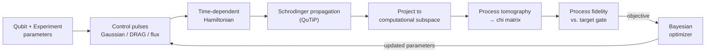
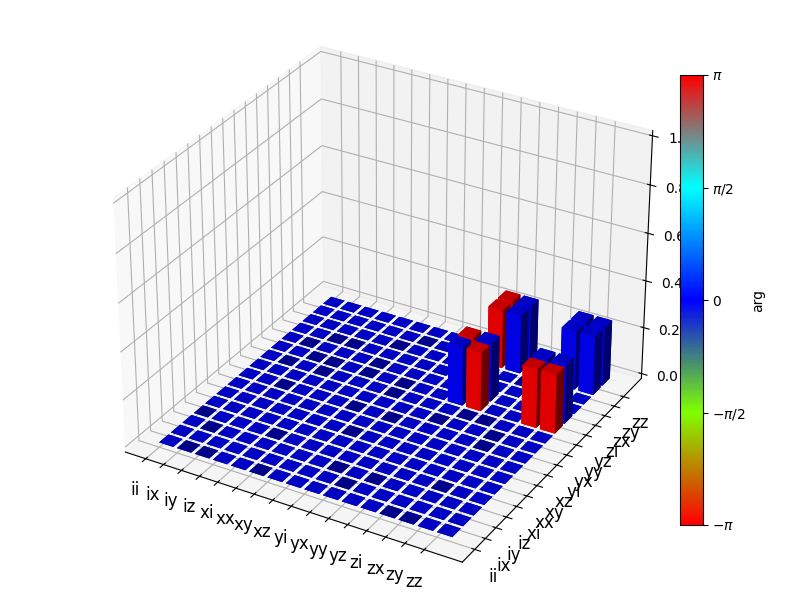
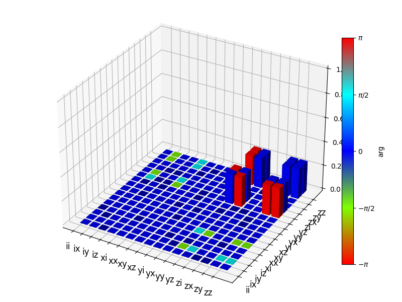
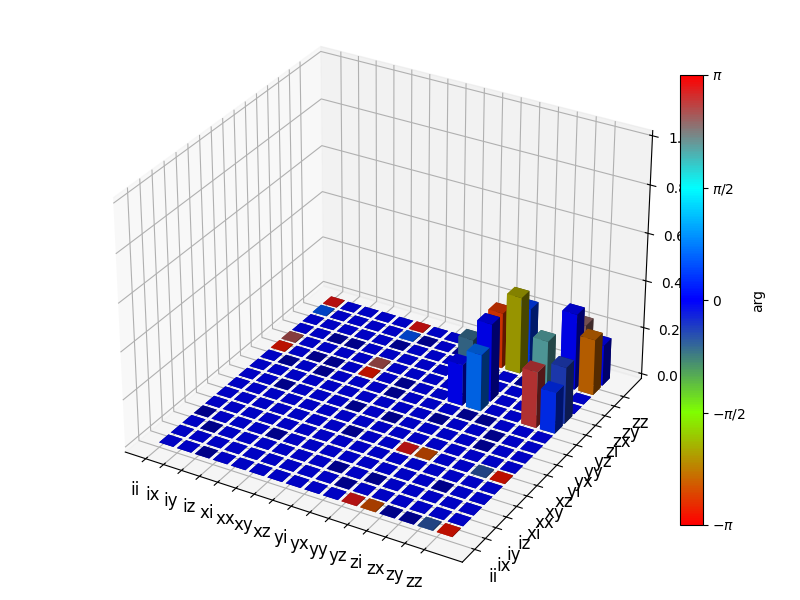
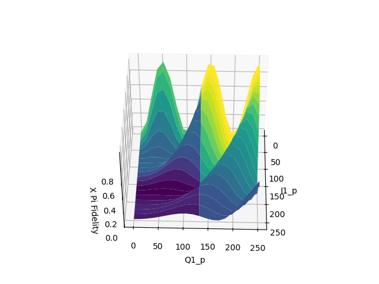
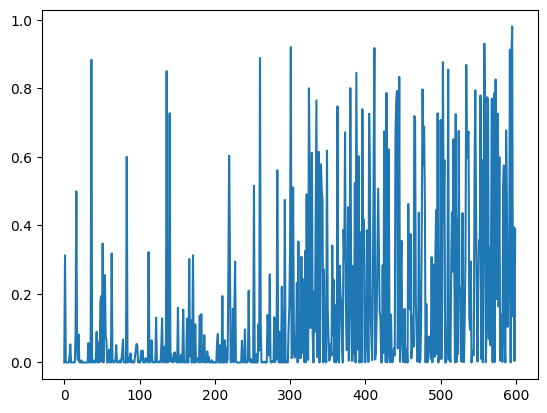
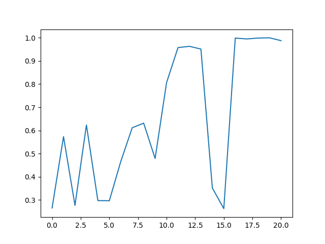
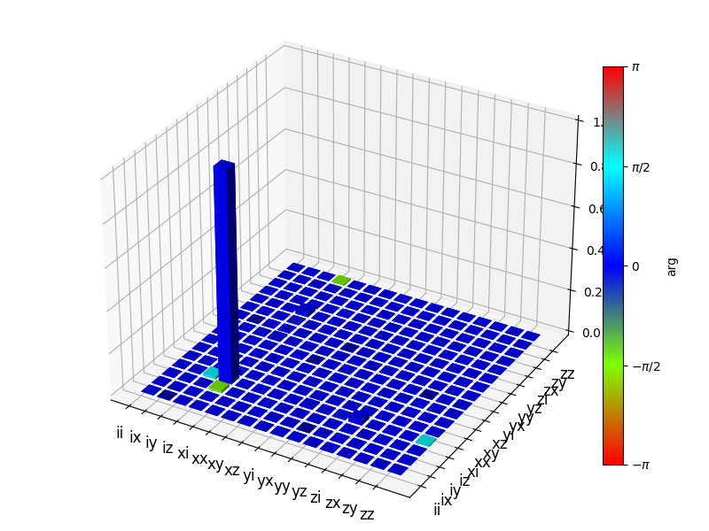
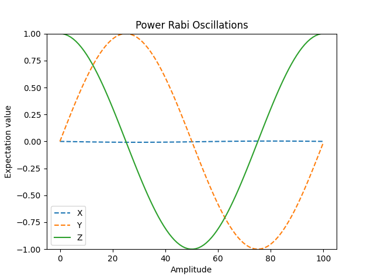

# Two-Qubit Transmon Auto-Tuning

**Simulating superconducting-qubit gates and automatically tuning their control pulses to near-unit fidelity.**


This project builds a physically-realistic simulator of two capacitively-coupled
**transmon qubits** and then uses **Bayesian optimization** to discover the
control-pulse parameters that realize high-fidelity quantum gates — the same
"calibration" problem faced on real superconducting hardware, solved in
simulation. Each qubit is modelled as a **three-level system** so that leakage
out of the computational subspace is measured rather than ignored, and gate
quality is scored with full **quantum process tomography**.

### Headline results

| Gate | How it's realized | Tuned by | Process fidelity |
|------|-------------------|----------|:----------------:|
| **CPHASE / CZ** | Flux-tune qubit into the \|11⟩–\|20⟩ resonance + virtual-Z correction | Bayesian optimization | **0.9998** |
| **X** (single-qubit) | Resonant microwave drive | Bayesian optimization (~40 evals) | **≈0.99** |
| **CPHASE** (meta-tuned) | As above | Bayesian optimization *of the optimizer's own hyperparameters* | **0.9996** |

> Fidelity is the process fidelity `Tr(χ_ideal · χ_real)`; for these unitary
> targets it is 1.0 for a perfect gate (verified numerically), so 0.9998 means a
> 99.98%-faithful gate.

---

## How it works



**1. The physics.** Two transmons are modelled as coupled anharmonic oscillators,
each truncated to three levels (|0⟩, |1⟩, |2⟩). The time-dependent Hamiltonian
includes each qubit's frequency and anharmonicity, in-phase/quadrature (I/Q)
microwave drives, and an exchange coupling `g` between the qubits. Working in
angular-frequency units, `6 · 2π` denotes a 6 GHz transmon.

**2. Gate synthesis.**
- *Single-qubit gates* (X, Y, Y/90, H) are driven by shaped microwave pulses.
  Gaussian and **DRAG** pulse shapes are implemented, the latter to suppress
  leakage into |2⟩.
- *The two-qubit CPHASE* is realized by **flux-tuning** qubit 1 along a
  piecewise-linear trajectory so that |11⟩ is brought into resonance with |20⟩.
  The conditional phase accumulated at this avoided crossing implements the gate;
  the leftover single-qubit phases are removed by **virtual-Z** rotations in
  software (a free, instantaneous correction on real hardware).

**3. Evaluation.** The Hamiltonian is propagated with QuTiP, the resulting unitary
is projected onto the 4-dimensional computational subspace, and **quantum process
tomography** reconstructs the process (χ) matrix. Comparing χ against the ideal
gate's χ gives a single scalar fidelity — the objective the optimizer maximizes.

**4. Auto-tuning.** The fidelity landscape is non-convex, periodic, and expensive
to evaluate, so a **Gaussian-process Bayesian optimizer** searches it, reaching
high fidelity in tens of evaluations instead of an exhaustive sweep. A second,
**nested ("meta") optimization** tunes the optimizer's own hyperparameters
(acquisition weight, GP noise, number of init points and iterations).

---

## Results

### CPHASE gate — 0.9998 fidelity

The reconstructed process matrix (center) is visually indistinguishable from the
ideal CPHASE (left). Removing the virtual-Z correction (right) scrambles the
single-qubit phases — showing exactly what the correction fixes.

<table>
<tr>
<td align="center"><br><sub><b>Ideal CPHASE</b></sub></td>
<td align="center"><br><sub><b>Simulated + virtual-Z &rarr; <b>0.9998</b></b></sub></td>
<td align="center"><br><sub><b>Simulated, no correction</b></sub></td>
</tr>
</table>

### Bayesian optimization finds the optimum

The X-gate fidelity landscape (left) is riddled with ridges and local optima —
which is why plain grid search or gradient steps struggle. The optimizer's
fidelity climbs toward 1.0 as it explores (right).

<table>
<tr>
<td align="center"><br><sub><b>X-gate fidelity landscape (2D slice)</b></sub></td>
<td align="center"><br><sub><b>Fidelity vs. evaluation during optimization</b></sub></td>
</tr>
</table>

### Meta-optimization

Tuning the optimizer's *own* hyperparameters with an outer Bayesian loop drives
the CPHASE fidelity to **0.9996**, locking on after ~16 iterations.

<table>
<tr>
<td align="center"><br><sub><b>Fidelity vs. iteration with meta-tuned hyperparameters</b></sub></td>
<td align="center"><br><sub><b>Optimized single-qubit X process (chi)</b></sub></td>
</tr>
</table>

### Physics validation — power Rabi

Sweeping the drive amplitude produces clean Rabi oscillations (⟨Y⟩ and ⟨Z⟩
oscillate in quadrature while ⟨X⟩ stays fixed), confirming coherent driving of
the transmon.

<p align="center"></p>

*(Additional figures — ideal-gate references, DRAG-driven X, Y/90 fidelity, and
per-iteration Bayesian runs — are in [`docs/images/`](docs/images).)*

---

## Repository structure

```
two_qubit_transmon_auto_tuning/
├── simulation.py       # Core engine: Hamiltonian, pulses, propagation, QPT, fidelity
├── optimization.py     # Bayesian auto-tuning + nested meta-optimization
└── exploratory/        # Early standalone prototypes, kept for provenance
examples/
├── run_cphase.py             # Evaluate the tuned CPHASE gate + plot its chi matrix
├── optimize_x_gate.py        # Auto-tune an X gate from scratch with Bayesian opt.
└── plot_fidelity_landscape.py# Visualize the non-convex fidelity landscape
tests/                  # pytest suite (fidelity regressions, tomography sanity checks)
docs/
├── images/             # Result figures
└── results/            # Saved meta-optimization hyperparameters
```

## Installation

Requires Python 3.11+. The project uses [Poetry](https://python-poetry.org/); a
lockfile is committed for a reproducible environment.

```bash
git clone https://github.com/100-nali/Two-Qubit-Transmon-Auto-Tuning.git
cd Two-Qubit-Transmon-Auto-Tuning
poetry install
```

> **Note on plotting:** QuTiP 4.7's 3D tomography plots require `matplotlib < 3.8`
> (pinned in `pyproject.toml`); the numerical results are independent of this.

## Quickstart

```bash
# Reproduce the ~0.9998 CPHASE gate and view its process matrix
poetry run python examples/run_cphase.py

# Auto-tune an X gate from scratch (reaches ~0.99 in a few dozen evaluations)
poetry run python examples/optimize_x_gate.py

# Run the full pipeline: meta-optimize, then tune CPHASE
poetry run tqtat-optimize
```

Or use it as a library:

```python
from two_qubit_transmon_auto_tuning import (
    default_cphase_experiment, cphase_objective,
    run_bayesian_optimization,
)

experiment = default_cphase_experiment()
objective, bounds = cphase_objective(experiment)
optimizer = run_bayesian_optimization(
    objective, bounds, init_points=5, n_iter=16,
    acquisition_weight=4.75, alpha=0.072,   # meta-tuned hyperparameters
)
print(optimizer.max["target"])   # -> ~0.9996
```

## Tests

```bash
poetry run pytest            # full suite
poetry run pytest -m "not slow"   # skip the end-to-end optimization test
```

The suite checks that ideal gates score exactly 1.0 (validating the tomography
and fidelity metric), that the tuned CPHASE reproduces > 0.999, and that the
Bayesian optimizer actually tunes an X gate above 0.9 end-to-end.

## Tech stack

Python · [QuTiP](https://qutip.org/) (quantum dynamics & tomography) ·
[bayesian-optimization](https://github.com/bayesian-optimization/BayesianOptimization) ·
NumPy · SciPy · scikit-learn · Matplotlib · Poetry.

## Acknowledgments

Developed as a physics research project at the University of Oxford. Thanks to
**Joel Pendleton** for early collaboration on the project scaffolding and the
initial Bayesian-optimization interface, and to **Barnaby** for the theory notes
underpinning the transmon Hamiltonian.

## License

Released under the [MIT License](LICENSE).
